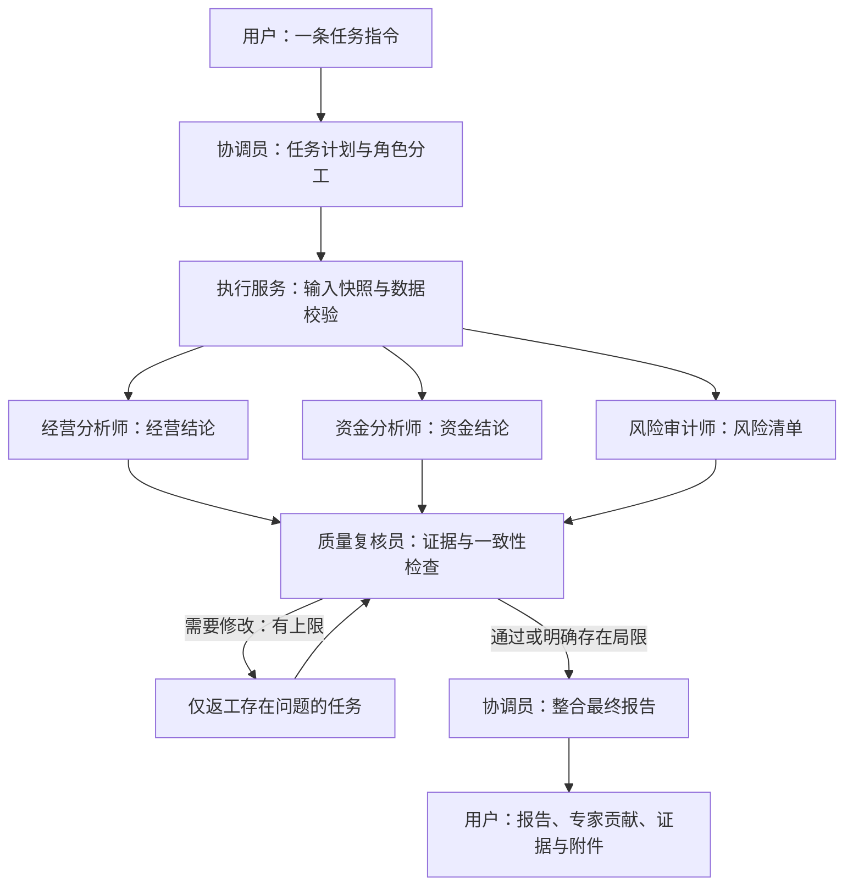
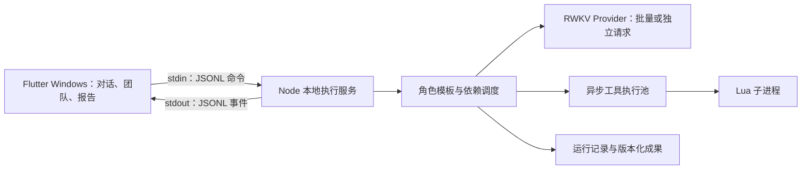

# RWKVBuddy 多 Agent 分析报表

日期：2026-11-12（北京时间）  
参考项目：`C:\Users\bay13\Documents\foreman-cli`  
目标项目：`C:\Users\bay13\Documents\RWKVBuddy\rwkvbuddy`

## 1. 结论与建议

**建议采用 Flutter 桌面界面 + Node.js 本地执行服务，复用 foreman-cli 的 RWKV 请求、独立会话、工具和财务核算能力，新增依赖调度、角色定义、结构化事件与成果管理。** 这条路线能利用现有 Windows 环境，同时把终端上的“多路算账”发展成用户可见的“多位专家合作交付”。

两项要求都具备实现基础，但参考项目当前尚未完整满足：

| 用户要求 | 参考项目现状 | RWKVBuddy 应达到的行为 |
|---|---|---|
| Windows 上多个 Agent 并行协作 | Windows 的 Node/Lua 可运行；会话独立；支持服务端批量推理。批次和本机工具目前存在串行等待 | 独立任务并发推进；模型请求与工具各有限流；一个专家失败时，其他独立任务继续 |
| 像 WorkBuddy 一样，由多个角色完成一次任务，且用户能够感知 | 按公司或门店分配同类 worker，显示读取、计算、提交；缺少专家职责、任务依赖和跨角色复核 | 用户看到谁负责什么、谁正在工作、结论如何交接、谁完成复核，最终交付一份有专家贡献和证据的报告 |

本报告把“类似 WorkBuddy”理解为以上交互目标，没有对 WorkBuddy 的内部实现或当前产品功能作验证。当前交付是分析与实施设计，尚未将多 Agent 功能实现到 Flutter 应用。

**首期选择一个可验证的任务模板：经营与资金分析。** 先用真实的职责、工具和成果证明协作成立，再扩展文档研究、代码分析等任务模板。角色数量按任务需要决定，简单问题直接处理，无需强行启动整支团队。

## 2. 分析依据和验证边界

分析对象是参考项目的**当前工作副本**，包含已有未提交修改和 Windows 打包脚本。参考仓库 HEAD 为 `3d6903506a98282db9eb8d350961a0e7dc0cf687`；仅凭该提交不能完整复现当前副本，关键文件 SHA-256 另存于验证记录。本次没有修改参考项目的源文件。

目标项目目前仍是 Flutter 计数器应用，尚无模型连接、任务调度、专家面板或成果存储。此前已在本机通过 Flutter 3.32.7 / Dart 3.8.1 的 Windows Release 构建，这只证明桌面应用构建环境可用。

| 验证项 | 本次结果 | 能支持的判断 |
|---|---|---|
| Node / Lua 环境 | Node v24.15.0；Lua 5.4.6；Windows 原生运行 | 可采用 Node 本地服务执行现有工具 |
| `npm run check` | 通过；发现 68 个财务 job，核心财务样例、意图解析及紧凑报表检查通过 | 现有财务和意图处理具备回归基线 |
| `tsc --noEmit` | 通过 | 当前参考代码类型检查通过 |
| P01：真实异步 Lua 子进程 | 两个子进程生命周期重叠，均正常输出，Node 事件循环仍响应 | Windows 可以并发运行本机工具；不需要以 WSL 为前提 |
| P02：模拟 5 个 prompt，wave=2 | 请求批次为 2、2、1；同时进行的请求峰值为 1 | 当前 wave 是依次执行的批次，不是多个 HTTP 请求同时进行 |
| P03：模拟两个异步工具 handler | 工具 handler 的执行峰值为 1 | 当前 worker 工具处理串行 |
| P04：注入未捕获工具异常 | 整个运行 Promise 被拒绝，另一个 worker 工具未执行 | 缺少逐任务异常隔离；并非所有普通工具错误都会如此，返回 `ERROR` 的情况另有处理 |
| P05：会话文件隔离 | 两个会话仅获得各自提供的文件 | VirtualFs 具有逻辑隔离；不代表操作系统级沙箱 |
| P06：错误收入、正确利润 | 错误收入仍被保留；空提交可由本地结果补齐，未附来源字段 | 现有复核未覆盖全部金额字段，也未明确标记本地兜底 |
| P07：末尾 SSE 行没有换行 | 最后一行内容丢弃 | 截断流需要显式失败或恢复，不能作为正常空结果结束 |
| P08：同一 batch 的不同 token 配额 | 请求 11 与 99，实际共享参数为 11 | 批处理使用首条参数，异构专家需要分组或分别请求 |

P02—P05、P07—P08 使用模拟模型/网络响应，不会调用外部推理服务；P06 使用真实 fixture 和本机 Lua。**本次没有进行真实 RWKV 服务并发测试，因此不能承诺 16、64 或 128 路的吞吐量、显存用量、响应时间或提速倍数。**

可复现脚本：[foreman-multi-agent-probe.mjs](./foreman-multi-agent-probe.mjs)  
机器可读结果：[foreman-multi-agent-evidence.json](./foreman-multi-agent-evidence.json)

在当前开发机复现：

```powershell
Set-Location 'C:\Users\bay13\Documents\foreman-cli'
npm run check
.\node_modules\.bin\tsc.cmd --noEmit
node --import tsx 'C:/Users/bay13/Documents/RWKVBuddy/rwkvbuddy/docs/analysis/foreman-multi-agent-probe.mjs' 'C:/Users/bay13/Documents/foreman-cli' 'C:/Users/bay13/Documents/RWKVBuddy/rwkvbuddy/docs/analysis/foreman-multi-agent-evidence.json'
```

探针需要参考项目已安装的 `tsx` 和可用的 Lua；会覆盖指定的验证 JSON。现有 `npm run check` 会在系统临时目录生成测试台账，Lua 调用也会使用临时目录。

## 3. 源码能力与缺口对照

| 编号 | 源码位置 | 已具备能力 | 迁移判断 |
|---|---|---|---|
| F01 | [session.ts:71](/C:/Users/bay13/Documents/foreman-cli/src/session.ts:71) | 每个会话独立 prompt、VirtualFs、工具记录和结束状态 | 复用会话结构，补 role、task、artifact 和 attempt 标识 |
| F02 | [rwkv-batch.ts:90](/C:/Users/bay13/Documents/foreman-cli/src/rwkv-batch.ts:90) | 按 wave 切片；SSE 按 choice.index 分发 | 复用协议适配；拆开 batch 大小、请求并发和会话并发配置 |
| F03 | [session.ts:147](/C:/Users/bay13/Documents/foreman-cli/src/session.ts:147) | 同一轮收齐所有 active 输出，再依次处理工具 | 改为任务就绪即推进，避免所有专家等待最慢会话 |
| F04 | [tools.ts:50](/C:/Users/bay13/Documents/foreman-cli/src/tools.ts:50) | 本机 Lua、8 秒超时、虚拟文件输入、重复执行抑制 | 保留计算能力；将 spawnSync 改成异步 spawn，加限流和取消 |
| F05 | [jobs.ts:62](/C:/Users/bay13/Documents/foreman-cli/src/jobs.ts:62) | 按公司/资金任务切文件 | 文件选择仍绑定财务命名，`_hinted` 未使用；需要通用输入清单 |
| F06 | [sketches.ts:45](/C:/Users/bay13/Documents/foreman-cli/src/sketches.ts:45) | 利润或资金模板提示词，要求复制标准 Lua | 适合首期财务模板；没有任意专家角色注册机制 |
| F07 | [jobs.ts:111](/C:/Users/bay13/Documents/foreman-cli/src/jobs.ts:111)、[view.ts:219](/C:/Users/bay13/Documents/foreman-cli/src/view.ts:219) | 流式文本、真实工具参数/结果、阶段与完成状态 | 事件来源可借鉴，需从终端渲染中拆出结构化事件 |
| F08 | [finance.ts:106](/C:/Users/bay13/Documents/foreman-cli/src/finance.ts:106) | 本地标准脚本复算，必要时替换 worker 输出 | 有价值，但只比较 profit/net；需全字段验证和来源标记 |
| F09 | [repl.ts:158](/C:/Users/bay13/Documents/foreman-cli/src/repl.ts:158) | 扫工作区、意图路由、派发、核算、输出 | 可提取运行流程，但未形成通用依赖图、复核返工或持久化执行器 |
| F10 | [package-windows.ps1:1](/C:/Users/bay13/Documents/foreman-cli/scripts/package-windows.ps1:1) | 复制 Node、Lua、lua54.dll 和运行依赖形成便携包 | 可借鉴分发方式；本次未执行打包、未验证干净机器安装 |

### 并行能力应分四层理解

1. **会话并发：已有。** 多个独立会话同时存在，输入和输出相互区分。
2. **服务端批量推理：客户端协议已有。** 同一个请求传入多条 prompt；服务端是否真正同时计算、能容纳多少条，需要实测。
3. **本机工具并发：当前没有。** 会话之间 `await applyOutput` 串行，Lua 又通过 `spawnSync` 阻塞 Node 事件循环。只把循环改成 `Promise.all` 不能解决同步进程阻塞。
4. **专家之间协作：待建设。** 当前主要是同类任务按数据分片，再用确定性代码汇总；缺少一个专家消费另一个专家成果、提出异议并返工的流程。

例如 128 个 job、wave=16，在每轮生成中会依次发送最多 8 个 batch。展示为“128 项任务，当前批次最多 16 个会话”更准确；不能由此声称 128 个 Agent 全程同时执行。

另一个接入限制是：非 CUDA 路径虽然使用 `/chat/completions`，请求仍带自定义 `contents`。不能据接口名称推断其兼容任意聊天服务；需分别实现并验证 batch 与单会话 provider。

## 4. 推荐产品流程：一个入口，一支专家团队，一份成果

用户示例：**“分析这三家公司的经营与资金情况，指出异常并给我一份报告。”**

首期使用 5 种角色，其中协调员兼任最终报告编辑，避免纯为展示而多开一次会话。

| 角色 | 职责和独立产出 | 输入 | 与其他角色的交接 |
|---|---|---|---|
| 任务协调员 | 识别任务、选择模板、分配范围、组织最终报告 | 用户指令、文件清单、约束 | 发布任务计划；根据复核结果汇总成果 |
| 经营分析师 | 收入、成本、利润、公司间差异 | 固定版本台账和核算结果 | 经营结论和证据交给复核员 |
| 资金分析师 | 已入账收支、净流入、对手方分布 | 固定版本资金流水 | 资金结论和证据交给复核员 |
| 风险审计师 | 缺失数据、异常记录、适用口径和分析局限 | 同一输入快照和确定性校验结果 | 独立风险清单交给复核员 |
| 质量复核员 | 对照来源检查三份成果，发现矛盾或无证据结论 | 各专家成果、输入摘要、校验规则 | 通过，或明确指出哪份成果需要修改 |

专家必须拥有不同的任务目标、输入范围、工具授权或输出结构；只有不同头像和名字不构成多角色协作。可以让多个专家使用同一个 RWKV 模型，但同模型的结论可能存在共同错误，不能把“多人赞同”当作正确性的证据。



经营、资金、风险任务在数据准备后并行；复核依赖这些成果，报告依赖复核结果。返工应创建新 attempt 和新成果版本，保留历史；最多一次自动返工可作为首期默认策略，仍无法解决时报告明确标记待确认。具体上限可配置。

首期已有 fixture 只有利润口径台账与资金流水，不能据此推断账龄、银行余额、应收账款或现金流完整性。缺失数据应出现在“分析局限”中，需要更多资料时由协调员集中提出，避免每位专家重复提问。

## 5. 如何让用户感知协作

### 5.1 界面应展示的四类信息

| 界面区域 | 用户可见内容 | 驱动来源 |
|---|---|---|
| 主对话 | 用户指令、团队计划、需要补充的信息、最终答复 | 用户输入、已校验计划、协调员摘要 |
| 专家团队区 | 每位专家的职责、当前任务、状态、最近一条成果 | 调度器状态和工具结果摘要 |
| 协作时间线 | 谁接到了任务、何时交付、谁发现问题、成果交给了谁 | 实际任务/工具/成果事件 |
| 报告与附件区 | 当前成果版本、章节来源、复核状态、打开/导出 | 成果索引与复核记录 |

宽屏可采用“主对话 + 右侧专家团队/成果详情”；窄窗口用同一任务页中的团队与成果页签。普通用户先看到自然语言摘要，技术日志放在可展开的详情内。

示意内容如下，**这是拟议界面文案，不是本次已发生的专家运行**：

```text
你：分析三家公司的经营与资金情况，指出异常并给我报告。

协调员：已安排经营、资金、风险三个方向并行分析，完成后统一复核。

经营分析师  · 分析中      对比三家公司的收入与成本
资金分析师  · 已提交      已完成资金净流入分析 → 等待质量复核
风险审计师  · 分析中      检查遗漏记录和核算口径
质量复核员  · 等待        还需经营与风险两份成果

协作记录
资金分析师提交《资金分析 v1》
质量复核员指出：一项结论缺少来源行号 → 已退回补充
资金分析师提交《资金分析 v2》 → 复核通过

最终成果：《经营与资金分析报告》
经营章节由经营分析师提供；资金章节由资金分析师提供；
风险章节由风险审计师提供；质量复核员完成来源核对。
```

### 5.2 可感知必须对应真实状态

- 运行由调度器启动事件确认；等待模型、等待依赖、等待工具资源分别标记，不能统一显示“分析中”。
- 提交与复核通过是不同状态；只有成果保存和校验成功后才能显示“已提交”，复核结束后再标“已复核”。
- 展示任务说明、执行动作、发现、交接和结果，不需要展示模型内部推理过程，也不应把未解析完成的工具 JSON 当作正式进度。
- 没有完成总量时使用阶段状态；有明确数量时显示“已核对 2/3 份台账”，避免编造百分比和预计时间。
- 一个专家失败时，显示影响范围和是否可重试；最终报告标“部分完成”，列出缺失成果。不能让本地兜底结果伪装成专家已成功完成。
- 最终报告每个主要章节关联作者、来源文件、成果版本和复核结论，用户可以追溯，不必阅读完整日志。

## 6. Windows 技术方案

### 6.1 路线比较

| 方案 | 优点 | 主要成本 | 判断 |
|---|---|---|---|
| Flutter + Node 本地执行服务 | 直接利用现有 TS 会话、RWKV 协议、Lua 及财务逻辑；Windows 已有运行基础 | 随包携带 Node/Lua，管理进程生命周期与 IPC | **首期推荐** |
| Flutter / Dart 完整重写 | 单语言维护，更少运行时分发组件 | 会话、SSE、工具、财务规则均需重写并对齐验证 | 已有逻辑稳定、团队决定统一 Dart 后再评估 |
| 只启动现有 CLI 并解析终端文字 | 可快速查看现有演示 | ANSI 文字不稳定；难以区分事件、结果和错误；取消与恢复困难 | 仅用于开发演示，不作为产品接口 |

### 6.2 推荐连接方式



本地服务通过标准输入/输出通信，首期无需额外监听本地端口。Flutter 使用 `Process.start` 启动随包 `node.exe`，`runInShell: false`，通过参数数组传路径；JSONL 承载中文任务内容。stderr 留给诊断日志，stdout 只输出协议数据。Dart 端使用 UTF-8 流解码后按行解析，防止中文跨 chunk 被截断。

参考分发结构：

```text
RWKVBuddy/
  rwkvbuddy.exe
  [Flutter 所需 DLL 与 data/]
  agent-service/
    service.mjs
    runtime/node.exe
    runtime/lua.exe
    runtime/lua54.dll
    lua/sandbox.lua
    [实际需要的运行依赖]
```

服务端 JS 构建为发布产物；不要在终端用户机器上临时 `npm install`。所有资源路径以可执行文件或服务文件位置解析，不依赖启动时的工作目录。运行记录与报告写到应用用户数据目录，允许用户另选导出位置，避免安装目录权限影响。

Windows 必须覆盖带空格/中文的路径、Lua DLL 寻址、进程无可见控制台、应用退出后的子进程回收。Node 工具调用设 `windowsHide: true`；涉及整个子进程树的回收需使用 Windows Job Object 或等效方案，不能假设终止父 Node 就会自动终止 Lua。

### 6.3 调度方式和并发参数

采用“固定模板生成依赖图 + 就绪队列 + 受限并发”。首期不依赖模型临时生成任意可执行工作流；协调员提出的任务范围也必须通过模板和输入校验。

| 参数 | 首期建议起点 | 约束 |
|---|---|---|
| 同时推进的专家任务 | 3 | 建议值，尚未测得最佳值；不得超过 provider 与本机资源预算 |
| 同时进行的模型 HTTP 请求 | 无 batch 时先从 2 开始；batch 后端先保持 1 | 在真实服务测量后调整；不能将 wave 当作请求并发数 |
| 单个推理 batch 的大小 | 由后端验证决定 | 同一模型、认证上下文、采样参数、停止条件和 token 预算才合批 |
| 同时运行的 Lua 子进程 | 2 | 本机已验证两个进程可重叠；重负载上限仍需测量 |
| 自动返工/重试预算 | 先各限制为 1 次 | 以任务和错误类型决定，不能无限重试 |

让单个专家的“生成 → 工具 → 再生成”独立推进：一个专家调用工具时，其他就绪专家可以申请推理资源。受限并发的 `Promise.allSettled` 可用于启动彼此独立的异步任务，但调度器仍须表达依赖关系，并隔离错误；不能对整张图无差别全量启动。

取消信号需要贯穿运行、模型请求、流读取、队列和工具进程。设置连接、首 token、流空闲、总运行及工具各自的超时；任务进入终态后丢弃迟到事件。取消一个专家不应默认取消整个任务，取消整个任务则应停止所有等待和运行中的工作。

### 6.4 最小数据契约

| 对象 | 必要字段 | 用途 |
|---|---|---|
| Run | runId、用户指令、workspace、输入快照、任务模板版本、状态、时间 | 用户任务的边界 |
| AgentRole | roleId、职责、提示词版本、允许工具、输出结构 | 专家定义与运行时授权 |
| Task | taskId、roleId、dependsOn、inputArtifacts、状态、attempt、资源需求 | 调度与重试 |
| Artifact | artifactId、version、producerTaskId、inputHashes、path、摘要、验证状态 | 专家之间交换可追溯成果 |
| Event | protocolVersion、runId、taskId、roleId、attempt、seq、timestamp、type、payload | 同步界面和重放执行过程 |

任务状态建议：`queued → ready → running → submitted → verified`，并允许 `waiting_model`、`waiting_tool`、`waiting_input`、`failed`、`cancelled`、`blocked`。整次任务区分 `completed`、`partial`、`failed`、`cancelled`；由规则根据必需成果计算，不能仅按“收到了 submit”决定。

事件示例：

```json
{
  "protocolVersion": 1,
  "runId": "run-example",
  "taskId": "cash-analysis",
  "roleId": "cash-analyst",
  "attempt": 1,
  "seq": 42,
  "timestamp": "2026-11-12T04:00:00Z",
  "type": "artifact.created",
  "payload": {
    "artifactId": "cash-summary",
    "version": 1,
    "summary": "资金分析已提交，等待质量复核"
  }
}
```

建议事件：`run.started`、`plan.created`、`task.state_changed`、`tool.started`、`tool.finished`、`artifact.created`、`review.requested`、`review.completed`、`run.finished`。UI 按 runId、taskId、attempt 关联并按 seq 去重；流式草稿可以节流显示，任务和成果事件不能丢失。

### 6.5 成果交接与正确性

各专家读取共同的只读输入快照，通过版本化 artifact 交接，避免并发修改同一份最终报告。协调员负责最终报告的单一写入。每个任务在自己的输出目录产生成果，验证成功后才发布给下游；返工发布新版本，并使旧版本的下游复核失效。

财务成果应保存结构化数值和核算口径，金额采用最小货币单位整数或适当精度的十进制定点运算。当前 Lua 的浮点计算与 `%.2f` 格式化足以支持现有样例，不等于已覆盖所有财务精度场景。核对实体、币种、收入、成本、税率、利润，以及收支笔数和金额等全字段，而不只比较利润或净流入。

每项重要结论关联文件、行号/记录标识、输入哈希与工具结果。来源标记区分模型生成、确定性工具计算、本地兜底和人工修订。复核员检查证据与逻辑，确定性代码负责能机械校验的规则。

将事件日志和成果索引持久化到用户数据目录，首期可用 JSONL + JSON 文件并原子发布成果。恢复时沿用已完成且输入哈希匹配的成果；中断任务标记为 interrupted/retryable。**保存历史记录与重放 UI，不等于恢复模型内部状态**，继续运行需要从受控输入重新执行未完成任务。

## 7. 实施拆分

以下是依赖顺序，未给出未经评估的工期承诺。

| 阶段 | 交付内容 | 完成标准 |
|---|---|---|
| A：提取本地执行服务 | 从 CLI 拆出可调用运行入口；JSONL 命令/事件；Flutter 连接与错误显示 | Windows UI 可启动服务、接收真实事件、取消、正常退出 |
| B：实现实际并行 | 异步 Lua、就绪队列、模型/工具限流、单任务异常隔离 | 两个独立工具任务重叠执行，心跳响应；失败不阻止无依赖任务 |
| C：形成专家协作 | 固定任务模板、三个专家、复核、有限返工、版本化成果 | 下游实际消费上游成果，并能复现一次有证据的退回与修订 |
| D：完成用户体验 | 团队职责、状态、协作时间线、报告贡献来源与附件 | 用户能辨认参与者、当前等待原因、成果作者和复核状态 |
| E：验证分发与服务能力 | Windows 便携构建、干净环境检查、真实 RWKV 并发与稳定性测试 | 不安装 Node/Lua 仍能使用；真实服务吞吐与限制有测量记录 |

建议新增模块边界：`protocol`、`roles`、`scheduler`、`providers`、`tools`、`artifacts`、`persistence`；Flutter 侧对应服务连接、任务状态模型、团队视图、成果视图。它们可以先位于现有仓库中的 `agent-service/` 和 `lib/`，无需首期拆多个仓库或引入微服务。

角色工具授权必须在执行器检查，不能只依赖提示词。参考 Lua/VirtualFs 主要提供逻辑文件视图和 Lua 环境限制；不应直接把它当成通用不可信代码的操作系统沙箱。首期延续只读分析和受控计算，未来支持文件修改时再定义输出所有权及冲突处理。

## 8. 验收报表

| 编号 | 场景 | 验收要求 | 验证方式 |
|---|---|---|---|
| W01 | Windows 原生运行 | 不依赖 WSL；发布包带齐必需运行时 | 干净 Windows 用户环境运行 |
| W02 | 工具并行 | 至少两个独立工具任务时间区间重叠；GUI 保持响应 | 带起止时间的真实进程日志与 GUI 心跳 |
| W03 | 模型并发 | 在选定 RWKV 后端验证 batch 或多请求行为；记录真实等待与资源上限 | 真实服务测试；区分队列时间、首 token、生成时间 |
| W04 | 资源限制 | 活跃模型请求、工具子进程都不超过配置 | 高于限额的任务集 + 活跃计数 |
| W05 | 异常隔离 | 一个专家工具失败，其他无依赖任务继续；最终明确部分完成 | 注入异常、缺失文件、工具超时 |
| W06 | 取消与退出 | 整任务取消后，限定时间内无遗留子进程；已完成成果仍保留 | 任务管理器或进程树检查 |
| W07 | 路径与编码 | 空格、中文、长内容与跨 chunk UTF-8 不破坏协议 | 指定路径和分块输入测试 |
| W08 | 流与恢复 | 断流明确失败；重复事件不重复成果；重启能查看历史和重试 | 截断 SSE、断进程、重放 JSONL |
| C01 | 专家分工 | 一条复杂指令产生至少两个有不同职责和独立成果的专家任务 | 检查模板、输入、工具和输出 |
| C02 | 依赖交接 | 复核读取实际成果版本；未就绪时不启动；返工使旧复核失效 | 输入哈希、artifact 版本及事件时间线 |
| C03 | 协作可见 | 用户可看到职责、真实动作、交付与复核，不依赖阅读原始日志 | 产品走查和用户任务测试 |
| C04 | 报告可信 | 重要数值全字段复算；章节有来源、作者、版本和状态 | 故意注入“利润正确但收入错误”等数据 |
| C05 | 兜底透明 | 不能将本地补齐的结果标为专家成功或复核通过 | 强制空提交/模型失败检查 UI 与报告 |
| C06 | 调度适度 | 简单问题无需启动整支团队；复杂任务可见实际并发 | 同一入口测试简单与复杂指令 |

并行收益用相同输入、模型、预算和后端分别跑“并发限制为 1”与目标并发，记录端到端时间、中位数与尾部耗时、失败率、token 和资源占用；确保成果质量一致后再评价提速。进程重叠、多个任务卡片、批量请求大小都不能单独证明总体提速。

## 9. 本次交付状态

- 已完成：参考项目源码分析、本机 Windows 工具并发验证、现有财务/意图回归检查、类型检查、8 项可复现探针、目标架构与界面流程、实施拆分和验收矩阵。
- 尚未实施：Flutter 专家协作界面、Node 执行服务、通用调度器、角色模板、成果管理和发布包。
- 仍需实测：选定 RWKV 服务的真实并发/批量能力、专业分析质量、干净 Windows 分发与进程取消行为。

推荐首个可演示闭环是：**用户给出一个经营与资金分析任务 → 三位专家并行产出 → 复核员核对并可退回修改 → 协调员交付带贡献来源的报告。**
